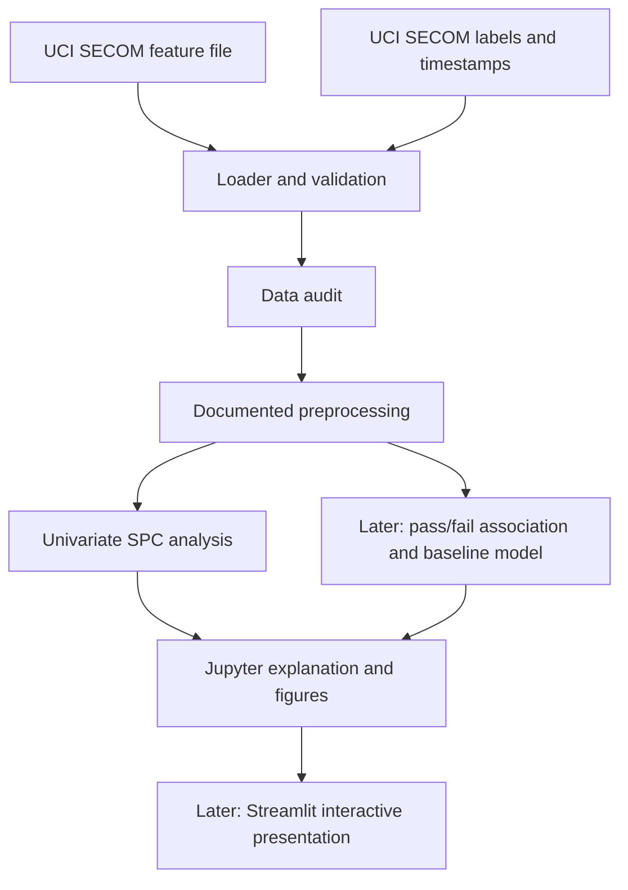

# System Architecture

## Architecture goals

- Keep the first version small and understandable for a Python learner.
- Separate original data, exploratory notebooks, reusable analysis functions, and later presentation.
- Make the analysis reproducible without a database or an HTTP API.
- Keep observations and simulated teaching examples clearly separated.

## Logical data flow



## Components

| Component | Responsibility | Planned location |
|---|---|---|
| Raw source data | Original downloaded files; never edited in place | `data/raw/` (normally not committed) |
| Jupyter notebooks | Learning notes, data audit, exploratory analysis, and figures | `notebooks/` |
| Reusable Python modules | Loading, validation, preprocessing, SPC calculations, and signal rules | `src/` |
| Tests | Small constructed examples for calculation and rule behavior | `tests/` |
| Streamlit app | Later browser-based view of reviewed analysis | `app.py` |
| Reports | Final narrative report and exported figures | `reports/` |
| Documentation | Product, requirements, data, architecture, and learning plan | `docs/` |

## Internal interfaces (Python API)

The initial design uses ordinary Python function interfaces, not public HTTP routes:

- `load_secom(data_dir)` returns measurements, labels, and timestamps.
- `validate_secom(features, labels, timestamps)` checks the expected structure and reports validation problems.
- `audit_features(features)` returns missingness, uniqueness, and constant-feature summaries.
- `prepare_features(features, policy)` applies an explicit, recorded policy.
- `compute_imr(values)` returns chart center lines and limits for an appropriate ordered series.
- `find_weco_signals(values, limits, rules)` returns flagged indices and rule identifiers.

Names are design sketches, not implemented interfaces; refine them with the learner before coding.

## Interface choice

Jupyter is for exploration and explanation. Streamlit is the planned interactive presentation layer. The Streamlit app can import the same Python functions used by notebooks. A separate REST API, Node service, or MongoDB database would add complexity without serving a current requirement.

## Repository layout

```text
semiconductor-process-monitor/
├── README.md
├── requirements.txt
├── docs/
├── data/
│   └── README.md
├── notebooks/
├── src/
├── tests/
├── reports/
└── app.py                 # added in the later dashboard milestone
```

## Security and reproducibility

- Do not commit credentials, access tokens, or private data.
- Record dataset source and license; avoid committing large raw files unless a clear need exists.
- Pin dependencies when the environment is established.
- Preserve a clean path to rerun analysis from source data.
